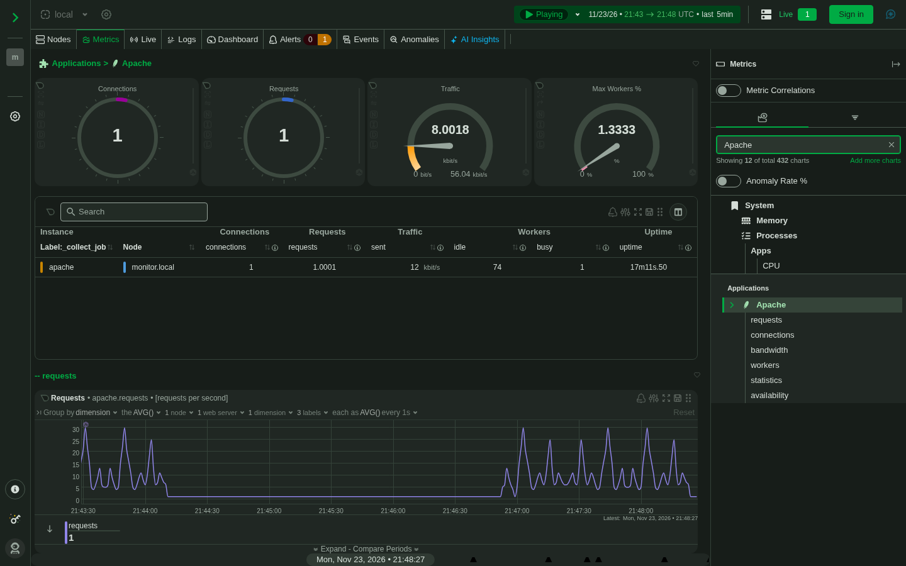
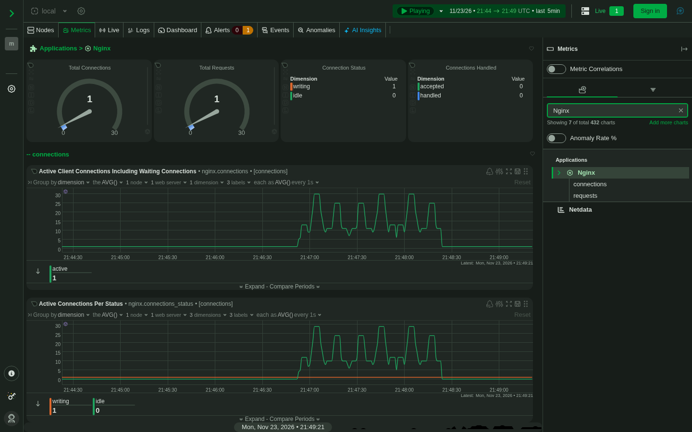
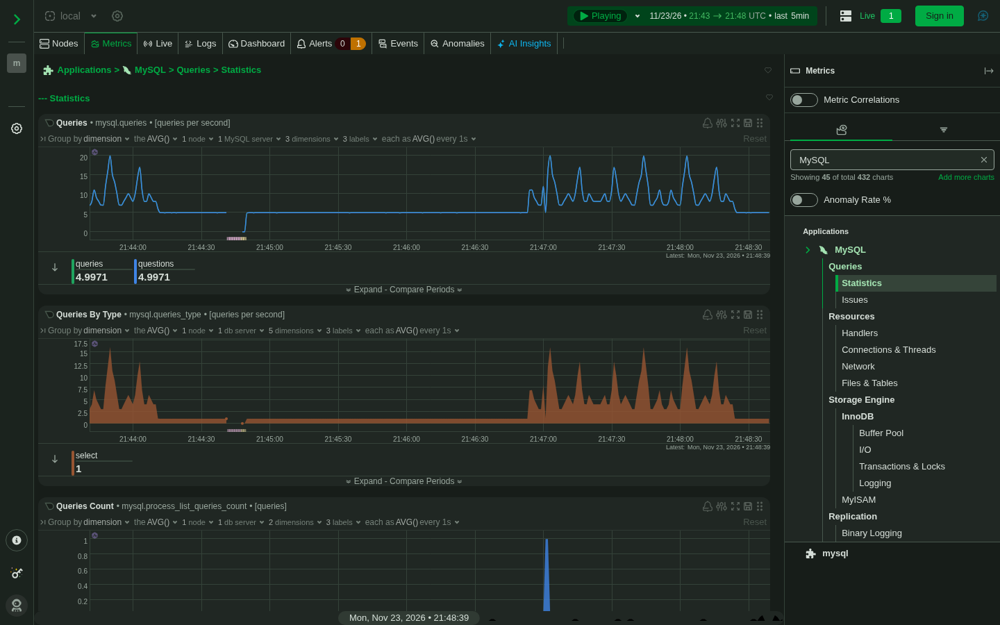
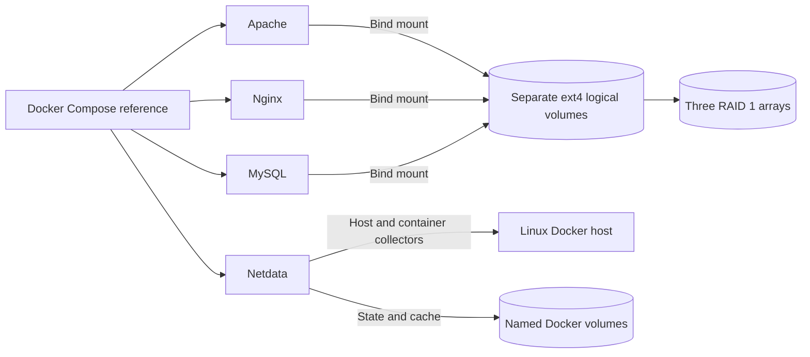

<!-- markdownlint-disable-next-line MD041 -->
<div align="center">

<h1>Enterprise Monitoring Stack</h1>

<p><strong>A lab reference for consolidating, persisting, and monitoring services on one Linux host.</strong></p>

<p>
<a href="https://github.com/diegnghtmr/enterprise-monitoring-stack/actions/workflows/ci.yml"></a>


<a href="LICENSE"></a>
</p>

<p>
<a href="https://diegnghtmr.me/en/work/enterprise-monitoring-stack/"><strong>Case study</strong></a> &bull;
<a href="#quick-start"><strong>Quick start</strong></a> &bull;
<a href="#architecture"><strong>Architecture</strong></a>
</p>

</div>

<p align="center"></p>

<a name="resumen-ejecutivo"></a>

This Universidad del Quindío infrastructure lab documents how Apache, Nginx, and MySQL can share a host without sharing a writable container layer. Each service has its own data mount, and Netdata makes service activity visible alongside system load. The repository is a deployment reference, not a ready-to-run production stack.

## Features

- **Independent service containers.** Keep the Apache and Nginx web roots separate from the MySQL database directory.
- **Mirrored lab storage.** Place a logical volume for each service on its own RAID 1 array and format it as ext4.
- **Data outside container lifecycles.** Bind-mount the service directories so edits and database records can survive restarts and replacement.
- **Host and service monitoring.** Use Netdata to inspect host resource usage and container activity; the dashboard captures below focus on service collectors.
- **Compose validation.** Check the committed deployment definition's syntax in CI without attempting to provision disks or build services.

## Preview

The Apache hero shows request bursts from a synthetic workload. These captures used named Docker volumes and network collectors on a local run, not the RAID/LVM or host-mount setup described in the lab.



Nginx separates client connections by state.



MySQL shows total query rate and the `SELECT` activity generated by fixture reads.

## Quick start

Install Docker with Compose to inspect the deployment. Validate the checked-in Compose configuration as CI does:

```sh
git clone https://github.com/diegnghtmr/enterprise-monitoring-stack.git
cd enterprise-monitoring-stack/docs
docker compose config -q
```

This is a syntax check, not a deploy. The [Compose reference](docs/docker-compose.yml) points to build contexts that are not present, and Apache and MySQL need an HTML fixture and SQL seed file that are not included. Its MySQL credential is an example in a lab file; replace it before running an adapted stack, and never reuse it elsewhere. A rebuilt lab would expose Apache on `8080`, Nginx on `8081`, MySQL on `3306`, and Netdata at `http://localhost:19999`.

| Variable | Purpose | Default |
| --- | --- | --- |
| `MYSQL_ROOT_PASSWORD` | Set a private MySQL root password in your adapted Compose file. | Supply `<your-password>`; do not reuse the lab value |
| `MYSQL_DATABASE` | Create the lab database on first initialization. | `proyecto_db` |

## Architecture

<a name="22-creación-de-arreglos-raid-1"></a>
<a name="29-montaje-y-configuración-permanente"></a>

The documented VirtualBox lab uses nine virtual data disks in three RAID 1 arrays. Each array backs an LVM logical volume mounted under `/srv` for one service. Mirroring is not a backup and does not protect against failure of the shared host.

<a name="51-despliegue-de-netdata-contenerizado"></a>
<a name="54-monitorización-de-contenedores-docker"></a>

The full lab gives Netdata host mounts and Docker socket access for collection; these are sensitive privileges and are not appropriate for an untrusted host. The case study captures instead used Apache status, Nginx connection counters, and MySQL status variables over the container network.



## Tech stack

| Layer | Technology |
| --- | --- |
| Lab host | VirtualBox, Ubuntu LTS |
| Storage | `mdadm` RAID 1, LVM, ext4 |
| Runtime | Docker Compose, Apache HTTP Server 2.4, Nginx stable, MySQL 8.0 |
| Monitoring | Netdata |

## Quality

CI runs `docker compose config -q` from `docs/`. The original lab walkthrough documents HTTP checks, SQL checks, and file or row persistence across container restarts. The portfolio capture run used substitute named volumes and supplied fixtures; it did not test disk failure, recovery, or host-mount collection. See the [case study](https://diegnghtmr.me/en/work/enterprise-monitoring-stack/) for what was exercised.

## Documentation

- [Lab and deployment reference](docs/lab-reference.md) covers VM sizing, the disk-to-container mapping, expected checks, and monitoring privileges.
- [Dockerfiles](dockerfiles/) and the [Compose reference](docs/docker-compose.yml) are source material for adapting the lab, not a complete deployable bundle.

## Team

Universidad del Quindío · Systems and Computing Engineering · Computational Infrastructure lab (November 2025).

- [Diego Flores](https://github.com/diegnghtmr)
- Edwin Viña
- Juan Pablo Mora

## License

[MIT](LICENSE).
